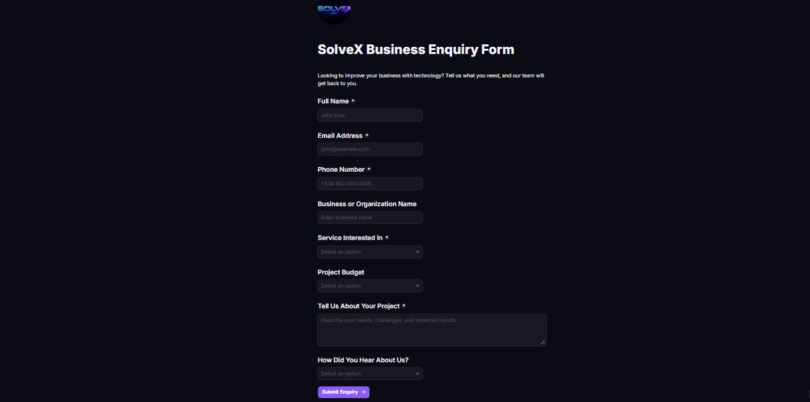
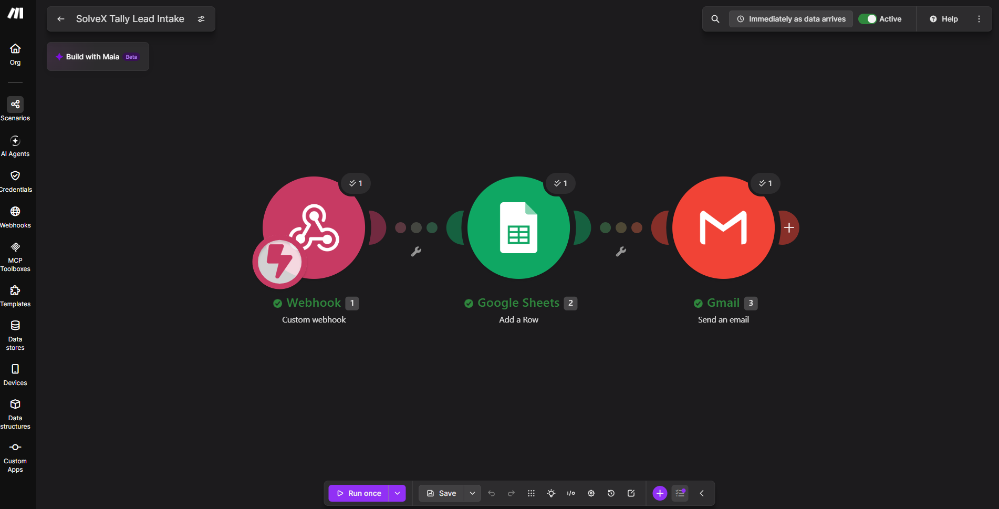
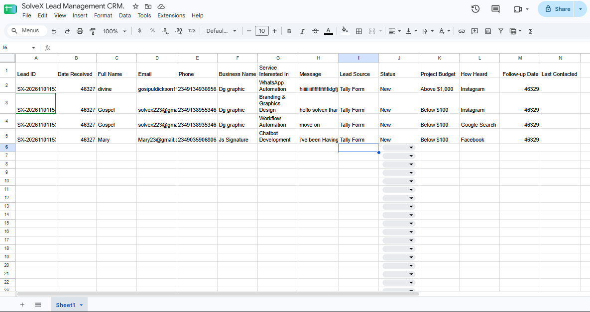
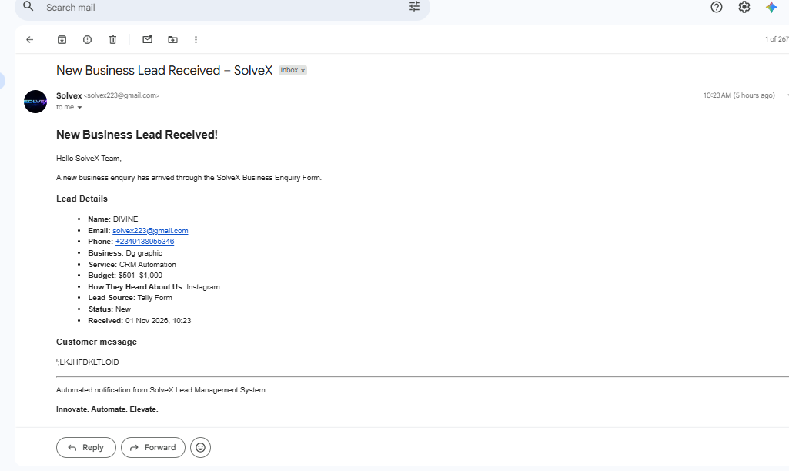
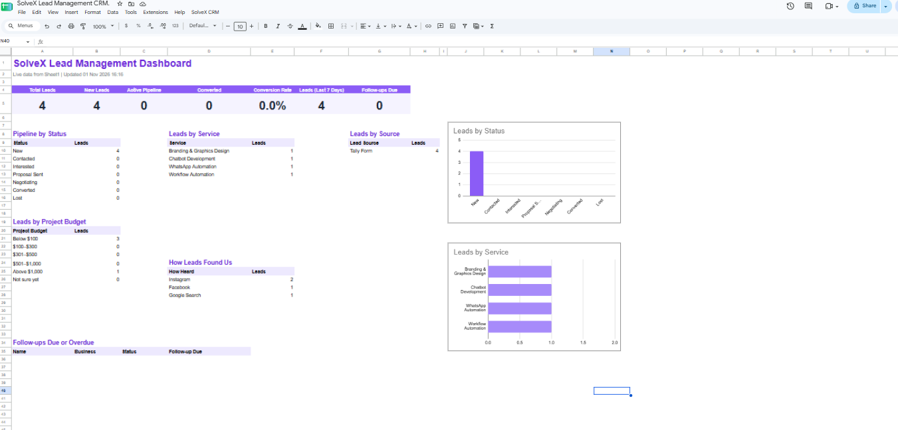

# SolveX Lead Capture & CRM Automation

An automated lead management system built by SolveX. It captures business enquiries, stores them in a Google Sheets CRM, notifies the team by email, and gives a live dashboard of lead activity.

## Overview

A prospective client fills in an online enquiry form. Within seconds the lead is saved in a CRM spreadsheet, the SolveX team gets an email, and the dashboard updates. No manual data entry is needed.

## Key Features

- **Lead Capture:** Structured Tally enquiry form (name, contact details, business, service, budget, project description, how they found us).
- **Workflow Automation:** Make.com receives each submission through a webhook and processes it.
- **CRM Storage:** Each lead is added to a Google Sheets CRM with an ID, date, source and status.
- **Email Notifications:** Gmail alerts the team to every new enquiry with the full lead details.
- **Status Tracking:** Dropdown pipeline stages (New, Contacted, Interested, Proposal Sent, Negotiating, Converted, Lost) with row colours.
- **Follow-up Tracking:** Follow-up dates are set automatically for new leads, with a Last Contacted column for manual updates.
- **CRM Dashboard:** An Apps Script dashboard shows totals, pipeline by status, leads by service, source and budget, and overdue follow-ups.

## System Architecture

```
Potential Customer
       |
       v
Tally Enquiry Form
       |
       v
Make.com Webhook
       |
       v
Google Sheets CRM -------> Gmail Notification
       |
       v
Status & Follow-up Tracking
       |
       v
CRM Dashboard (Apps Script)
```

## Technology Stack

| Technology | Purpose |
|---|---|
| Tally | Lead capture form |
| Make.com | Workflow automation |
| Google Sheets | CRM and lead database |
| Google Apps Script | Dashboard and follow-up reminders |
| Gmail | Email notifications |

## Workflow

1. A potential customer submits the SolveX enquiry form.
2. Tally sends the submission to a Make.com webhook.
3. Make.com maps the answers to CRM columns.
4. The lead is added to the Google Sheets CRM.
5. Gmail sends a notification about the new enquiry.
6. The team updates the lead's status as it progresses, and the dashboard reflects the change.

## Project Screenshots

### Tally Enquiry Form


### Make.com Automation Workflow


### Google Sheets CRM


### Gmail Notification


### CRM Dashboard


## Project Structure

```
solvex-ai-automation/
├── README.md
├── docs/
│   ├── architecture.md
│   ├── workflow.md
│   ├── setup-guide.md
│   ├── crm-dashboard.png
│   ├── gmail-notification.png
│   └── screenshots/
└── examples/
    └── sample-lead.json
```
## Installing the CRM Dashboard

The dashboard and follow-up reminders are powered by a Google Apps Script in [`scripts/crm-dashboard.gs`](scripts/crm-dashboard.gs).

1. Open your lead management Google Sheet.
2. Make sure the leads tab is named `Sheet1` and its columns are: Lead ID, Date Received, Full Name, Email, Phone, Business Name, Service, Message, Lead Source, Status, Project Budget, How Heard, Follow-up Date, Last Contacted.
3. Go to **Extensions → Apps Script**, delete the default code, and paste in the contents of `crm-dashboard.gs`.
4. Save, choose `buildDashboard` in the function dropdown, and click **Run**. Approve the permissions when Google asks.
5. A **Dashboard** tab appears, along with a **SolveX CRM** menu in the sheet.
6. Use **SolveX CRM → Turn on daily reminders** to receive a daily email listing leads whose follow-up date has arrived.

The script keeps no credentials. Reminder emails go to the spreadsheet owner unless `ALERT_EMAIL` is set at the top of the file.

## Business Value

This solution helps businesses:

- Respond to new enquiries faster.
- Cut repetitive data entry.
- Keep lead information in one organised place.
- See how many leads sit at each stage of the pipeline.
- Follow up consistently using due dates and status tracking.

## Limitations

- The CRM is a Google Sheets setup, suited to small teams and moderate lead volumes.
- Status and Last Contacted are updated manually by the team.
- The dashboard refreshes through formulas, and it is rebuilt from the SolveX CRM menu when its layout changes.

## Built By

**SolveX: AI Automation & Digital Solutions**

*Innovate. Automate. Elevate.*

Website: [https://solvex.com.ng](https://solvex.com.ng)
GitHub: [https://github.com/solvex223-hash](https://github.com/solvex223-hash)

---

*This repository documents a SolveX lead capture and CRM automation project. Screenshots use demonstration data. Customer information, webhook URLs and credentials are never published.*
